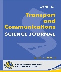

**Transport and Communications Science Journal**

# WAYPOINT TRAJECTORY TRACKING CONTROL OF A QUADCOPTER USING PROXIMAL POLICY OPTIMIZATION

**Pham Thi Ly1, Nguyen Vinh Hoang1**

1University of Transport and Communications, No 3 Cau Giay Street, Hanoi, Vietnam

## ARTICLE INFO

TYPE: Research Article
Received: … (edited by editors)
Revised: … (edited by editors)
Accepted: … (edited by editors)
Published online: … (edited by editors)
https://doi.org/10.1080/14680629.2017.1389072 (edited by editors)

* Corresponding author
Email:vinhhoang2001k60@gmail.com; Tel: 0349418809 (optional)

*@ 2026 University of Transport and Communications*
