

**Transport and Communications Science Journal**

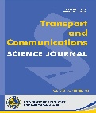

# WAYPOINT TRAJECTORY TRACKING CONTROL OF A QUADCOPTER USING PROXIMAL POLICY OPTIMIZATION

**Pham Thi Ly1, Nguyen Vinh Hoang1**

1University of Transport and Communications, No 3 Cau Giay Street, Hanoi, Vietnam

## ARTICLE INFO

TYPE: Research Article
Received: … (edited by editors)
Revised: … (edited by editors)
Accepted: … (edited by editors)
Published online: … (edited by editors)
https://doi.org/10.1080/14680629.2017.1389072 (edited by editors)

* Corresponding author
Email:vinhhoang2001k60@gmail.com; Tel: 0349418809 (optional)

*@ 2026 University of Transport and Communications*

# Abstract

This paper presents a waypoint-trajectory tracking control method for a quadcopter using Proximal Policy Optimization (PPO) in the ProjectAirSim simulation environment. The PPO agent is constructed using an Actor–Critic architecture and a 15-dimensional state vector comprising the position errors to the current and next waypoints, the quadcopter linear velocity, attitude, and angular velocity; its outputs are velocity commands along the three axes of the North–East–Down (NED) frame. The reward function consists of four components: waypoint-completion reward, safety-violation penalty, waypoint-approach reward, and velocity-alignment reward. After training, the agent weights are fixed and evaluated on a helical trajectory. The Carrot-Following (CF) algorithm is used as a reference method in the same simulation environment and on the same evaluation trajectory. The results show that, under the controller configurations adopted in this study, PPO achieves a shorter completion time and lower trajectory-tracking errors than CF. However, the PPO roll and pitch responses exhibit larger variations at several direction-change instants, indicating a tradeoff between rapid response and motion smoothness. These results demonstrate the feasibility of using a PPO policy to generate high-level velocity commands for waypoint-trajectory tracking in simulation.

**Keywords:** Quadcopter, trajectory tracking, waypoint tracking, Proximal Policy Optimization (PPO), reinforcement learning, Carrot-Following.

# 1. INTRODUCTION

Quadcopters are increasingly employed in applications such as infrastructure inspection, smart agriculture, and search-and-rescue missions \[1\]–\[3\]. In these applications, the ability to follow a predefined trajectory is an important requirement for autonomous operation. Nevertheless, quadcopter trajectory-tracking control remains challenging because of nonlinear dynamics, strongly coupled state variables, and underactuation \[4\], \[5\]. A variety of control approaches have been investigated for this problem, including PID and its variants \[6\], LQR \[7\], model predictive control \[8\], sliding-mode control, and robust nonlinear methods \[9\], \[10\]. These approaches can achieve good tracking performance under suitable conditions, but they typically require a dynamic model or a controller-design and parameter-tuning process tailored to each system configuration. Deep reinforcement learning (DRL) provides an alternative paradigm in which the control policy is learned through interactions between an agent and the environment rather than being directly derived from a system model. Recent studies have investigated DRL for quadcopter control and trajectory tracking, including model-free optimal control \[11\], comparisons of model-free algorithms for attitude control and trajectory tracking \[12\], real-time DRL-based control \[13\], and approaches based on DDPG \[14\], \[15\] and SAC \[16\]. Among Actor–Critic algorithms for continuous action spaces, DDPG \[17\], TD3 \[18\], SAC \[19\], and Proximal Policy Optimization (PPO) \[20\] are widely used. Although previous studies have demonstrated the potential of DRL for quadcopter control, the development of a high-level policy for waypoint-sequence tracking must simultaneously address three issues: providing sufficient information about the current target and the local progression direction of the trajectory, designing a sufficiently dense reward signal to guide learning, and separating high-level guidance from low-level dynamic-stabilization loops. Accordingly, this study employs PPO to construct a policy that generates velocity commands along the three NED axes, using a state representation that combines quadcopter motion information with relative errors to the current and next waypoints. The reward function consists of four components that jointly encourage waypoint completion, avoidance of unsafe states, reduction of the distance to the target, and alignment of the velocity direction toward the waypoint. The main contributions of this study are as follows:

- A PPO agent is developed for quadcopter waypoint-trajectory tracking within a hierarchical control architecture, where PPO acts as a high-level controller that generates velocity commands in the NED frame; the 15-dimensional state space combines the vehicle motion state with relative errors to the current and next waypoints.

- A multi-component reward function is designed to jointly promote waypoint completion, avoidance of unsafe states, reduction of the distance to the current waypoint, and alignment of the velocity direction toward the target.

- The PPO agent is evaluated on a helical trajectory using completion time, RMSE, and MAE; ten repeated trials are conducted, and the Carrot-Following (CF) algorithm is used as a reference method in the same simulation environment.

# 2. PROBLEM FORMULATION

The control objective is to drive the quadcopter sequentially through the waypoint set $W = \text{\{}w_{1},\ldots,w_{N}\text{\}}$, as illustrated in Fig. 1, in three-dimensional space. The i-th waypoint, $w_{i} = \left\lbrack x_{i},y_{i},z_{i} \right\rbrack^{T}$, and the quadcopter position at time t, $p_{t} = \left\lbrack x_{t},y_{t},z_{t} \right\rbrack^{T}$, are both expressed in the inertial North–East–Down (NED) frame.

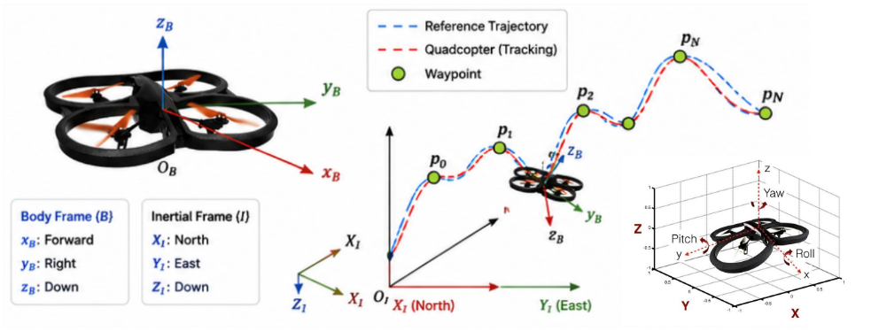

Fig. 1. Quadcopter waypoint trajectory-tracking problem formulation.

As shown in Fig. 1, quadcopter motion is described using two coordinate frames: the inertial frame {I} and the body-fixed frame {B}. The inertial frame describes the vehicle position and flight trajectory in the global space, where the $X_{I},Y_{I}$, and $Z_{I}$ axes correspond to the North, East, and Down directions, respectively. The body-fixed frame is attached to the quadcopter and consists of the $x_{B}$, $y_{B}$, and $z_{B}$ axes, which describe the vehicle motion direction and attitude. At each control instant, one waypoint is designated as the current target. Once the waypoint-completion condition is satisfied, the target is switched to the next waypoint until the entire waypoint sequence has been completed. The control problem is therefore to construct a policy capable of guiding the quadcopter through the waypoint sequence in the prescribed order while maintaining safe flight, reducing trajectory-tracking error, and shortening the completion time subject to the specified control constraints.

# PPO-BASED CONTROLLER DESIGN

Fig. 2 shows the hierarchical control architecture. The PPO agent uses the quadcopter state and reference-trajectory information to generate NED velocity commands, which are executed by the low-level flight-control loops in ProjectAirSim. Position, velocity, Euler angles, and angular velocity are fed back to form a closed-loop system. Agent design comprises the state space, action space, reward function, and an Actor–Critic network that learns the state-to-command mapping.

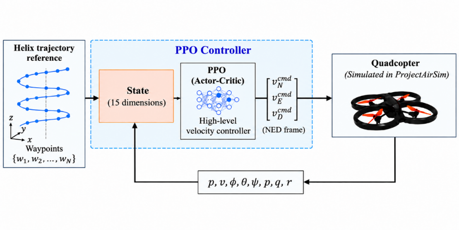

Fig. 2. Control architecture for quadcopter trajectory tracking..

## State Space Design

The state space combines trajectory geometry, translational motion, and attitude information. The current-waypoint error specifies the immediate target, while the next-waypoint error indicates the local trajectory direction and supports velocity adjustment between waypoints. The resulting state is the following 15-dimensional vector:

$$
s_{t} = \left\lbrack d_{x}^{i},d_{y}^{i},d_{z}^{i},d_{x}^{i + 1},d_{y}^{i + 1},d_{z}^{i + 1},v_{x},v_{y},v_{z},\phi,\theta,\psi,\dot{\phi},\dot{\theta},\dot{\psi} \right\rbrack^{\text{T}}
\tag{1}
$$

where:

- $d_{x}^{i},d_{y}^{i},d_{z}^{i}$i are the components of the relative position-error vector from the quadcopter to the ith waypoint along the three axes of the NED (North–East–Down) frame, defined by

$$
d_{i} = \omega_{i} - p_{t}
\tag{2}
$$

> where $p_{t} = \lbrack x,y,z\rbrack^{T} \in R^{\mathbb{3}}$ denotes the quadcopter position at time $t$, and $\omega_{i} = \left\lbrack x_{w},y_{w},z_{w} \right\rbrack^{T} \in R^{\mathbb{3}}\ $denotes the position of the $i - th$ waypoint;

- $d_{x}^{i + 1},d_{y}^{i + 1},d_{z}^{i + 1}$ are the components of the relative position-error vector from the quadcopter to the $(i + 1) - th$ waypoint;

- $v_{x},v_{y},v_{z}\ $are the components of the quadcopter linear velocity along the three coordinate axes;

- $\phi,\ \theta,\ \psi$ denote the roll, pitch, and yaw angles, respectively, describing the quadcopter attitude at time $t$;

- $\dot{\phi},\dot{\theta},\ \dot{\psi}$ denote the angular velocities about the roll, pitch, and yaw axes, respectively.

## Action Space Design

The PPO agent provides high-level guidance through velocity commands, while the flight controller retains the dynamic-stabilization loops. The continuous action space therefore comprises three components:

$$
a_{t} = \left\lbrack v_{N}^{\text{cmd}},v_{E}^{\text{cmd}},v_{D}^{\text{cmd}} \right\rbrack^{\text{T}}
\tag{3}
$$

where $v_{N}^{\text{cmd}},v_{E}^{\text{cmd}},v_{D}^{\text{cmd}}$ denote the commanded velocities along the North, East, and Down axes of the NED coordinate frame, respectively. The three action components correspond to the desired velocity commands in the North, East, and Down directions of the NED frame. The PPO policy does not directly issue thrust, control-moment, or individual-rotor-speed commands; instead, the velocity commands are passed to the flight controller integrated in ProjectAirSim for attitude stabilization and conversion into low-level control actions. Accordingly, PPO is treated as a high-level velocity-command policy. To ensure that the control signals remain within a suitable range, each action component is constrained by

$$
v_{N}^{\text{cmd}},v_{E}^{\text{cmd}},v_{D}^{\text{cmd}} \in \lbrack - 3.0,3.0\rbrack\,\text{m/s}
\tag{4}
$$

This constraint is implemented using the Box class of the Gymnasium library, ensuring that the velocity commands generated by the agent do not exceed the specified range during training and testing. Interactions between the PPO agent and the simulation environment are executed in lock-step mode with a fixed time step Δt = 0.05 s, corresponding to a control frequency $f_{c} = 1\text{/}\Delta t = 20\,\text{Hz}$

## Reward Function Design

The reward function promotes waypoint completion and safe flight while providing continuous feedback between waypoints. To reduce the sparsity of a completion-only reward, waypoint-approach and velocity-alignment terms are combined with the completion reward and safety penalty:

$$
R_{sum} = r_{waypoint} + r_{penalty} + r_{approach} + r_{align}
\tag{5}
$$

where:

- $R_{\text{sum}}$ is the total reward at time t;

- $r_{\text{waypoint}}$ and $r_{\text{penalty}}$ are the reward for waypoint completion and the penalty for violating a safety condition, respectively;

- $r_{\text{approach}}$ is the waypoint-approach reward, which encourages the quadcopter to reduce its distance to the current waypoint;

- $r_{\text{align}}$ is a continuous reward that encourages the quadcopter to maintain a velocity direction aligned with the direction from its current position to the waypoint..

**Waypoint-Completion Reward**

To encourage the quadcopter to complete the waypoints in the prescribed order along the reference trajectory, the reward is defined as follows:

$$
r_{waypoint} = \left\{ \begin{array}{r}
10\ if\ d\left( p_{t},w_{i} \right) < \epsilon\ and\ i < n\  \\
15 + 15*\frac{T_{\max} - t}{T_{\max}}\ \ \ if\ d\left( p_{t},w_{i} \right) < \epsilon\ and\ i = n\  \\
0\ otherwise
\end{array} \right.\
\tag{6}
$$

where $p_{t} \in R^{\mathbb{3}}$is the quadcopter position at time t, $\omega_{i} \in R^{\mathbb{3}}$ is the $i - th$ waypoint, $T_{\max}$ is the maximum number of steps in an episode, $r_{w} = 0.2\ m$ is the radius used to determine waypoint completion, and $\left( p_{t},\omega_{i} \right) = \text{|}p_{t} - \omega_{i}\text{|}_{2}$ is the Euclidean distance between the quadcopter and the target waypoint. The target waypoint is considered reached when $d\left( p_{t},\omega_{i} \right) < r_{w}$. Upon reaching an intermediate waypoint, the agent receives a positive reward. If the final waypoint is completed before the maximum number of episode steps is reached, the agent receives an additional reward that depends on the number of remaining time steps.

**Safety-Violation Penalty**

At each time step, if the episode terminates prematurely because the quadcopter collides with the ground, overturns, or moves excessively far from the target waypoint, the agent receives a large negative penalty:

$$
r_{\text{penalty}} = - 30
\tag{7}
$$

This mechanism acts as a safety constraint that encourages the quadcopter to avoid hazardous conditions, such as ground collisions, excessive roll or pitch angles $|\phi|$ or $|\theta| > \pi\text{/}2$, or excessive deviation from the target waypoint. Applying the same large penalty to these hazardous events emphasizes that any condition leading to premature episode termination is undesirable and should be avoided during flight. If no hazardous event occurs, the training process proceeds to evaluate the waypoint-completion condition.

**Waypoint-Approach Reward**

The waypoint-approach reward $r_{\text{approach}}$ is defined as

$$
r_{approach} = max\left\lbrack 0\ ,\ 5.0*\left( d(p_{t - 1},\omega_{i}) - d(p_{t},\omega_{i}) \right) \right\rbrack
\tag{8}
$$

where $d\left( p_{t - 1},\omega_{i} \right)$ and $d\left( p_{t},\omega_{i} \right)\ $denote the distances from the quadcopter to the $i - th$ waypoint at time steps $t - 1$ and $t$, respectively. This reward is designed to encourage the quadcopter to reduce its distance to the current waypoint at each time step. Accordingly, the agent receives a positive reward when the distance to the current waypoint decreases relative to the previous time step; otherwise, the reward is zero when the quadcopter does not move closer to the waypoint.

**Velocity-Alignment Reward**

The velocity-alignment reward $r_{\text{align}}$ encourages the quadcopter to maintain its direction of motion aligned with the direction from its current position toward the target waypoint. It is defined as

$$
r_{align} = \max\left( 0,0.2 \cdot v_{t} \cdot \frac{\omega_{i} - p_{t}}{d\left( p_{t},w_{i} \right)} \right)
\tag{9}
$$

where $v_{t} \in R^{\mathbb{3}}$ denotes the linear velocity vector of the quadcopter at time $t$. The reward is determined by the dot product between the velocity vector and the unit vector pointing toward the target waypoint. This component takes a positive value when the velocity vector has a component directed toward the waypoint, corresponding to an angle of less than $90^{\circ}$ between the two vectors. When the quadcopter moves perpendicular to or away from the waypoint, the reward is zero.

## Actor-Critic Network

With the state and action spaces defined, the policy-learning problem can be formulated as a mapping from the 15-dimensional state vector to three velocity commands in the NED frame. This mapping is learned using PPO with an Actor–Critic architecture.The high-level velocity controller is developed using the Proximal Policy Optimization (PPO) algorithm \[20\] with an Actor–Critic architecture. The Actor network maps the current quadcopter state to the desired velocity command, whereas the Critic network estimates the state value to support policy updates.Both the Actor and Critic take the state vector $s_{t} \in R^{15}$defined in section 3.1 as input. Before being fed to the networks, the state components are normalized to reduce the effect of scale differences among the observed variables. Each network contains two fully connected hidden layers, each with 64 neurons and a Tanh activation function.

# SIMULATION SETUP AND EXPERIMENTAL PARAMETERS

The simulation comprises PPO training and evaluation with fixed learned weights. Trajectory completion, completion time, and tracking error are assessed against Carrot-Following (CF) \[21\] in the same environment.

1.  **Simulation Environment**

The PPO agent is trained and evaluated in the ProjectAirSim simulation environment. This environment provides a real-time physics model of the quadcopter, enabling simulation of vehicle motion states, sensors, and dynamic interactions in three-dimensional space. In the simulation, the quadcopter has an X configuration with a body mass of approximately 1.0 kg. The propulsion system consists of four symmetrically arranged rotors with a 0.253-m spacing along the two body axes. Each rotor has a diameter of 0.2286 m and a maximum rotational speed of approximately 6396 r/min. Two rotors rotate clockwise and two counterclockwise to balance the overall reaction torque. The aerodynamic and lift parameters are specified according to the ProjectAirSim simulation configuration.

2.  **PPO Training Parameters**

The main training parameters of the PPO controller are summarized in Table I.

Table I. PPO training parameters

| **Parameter** | **Value** |
|:--|:--|
| Total training timesteps | 500,000 |
| Maximum timesteps per episode | 400 |
| Control period, $\Delta t$ | 0.05 s |
| PPO update interval | 2000 timesteps |
| Actor learning rate | $3 \times 10^{- 4}$ |
| Critic learning rate | $1 \times 10^{- 3}$ |
| Number of update epochs, K | 5 |
| Discount factor, $\gamma$ | 0.99 |
| GAE parameter, $\lambda$ | 0.95 |
| Clipping parameter, $\epsilon$ | 0.2 |
| Initial action standard deviation | 1.0 |
| Minimum action standard deviation | 0.1 |
| Action standard-deviation decay step | 0.01 |
| Action standard-deviation decay interval | 50 episodes |
| Number of neurons per hidden layer | 64 |
| Number of hidden layers in Actor/Critic | 2 |
| Activation function | Tanh |

3.  **Reference Method**

Carrot-Following (CF) is the reference method. This look-ahead algorithm guides the quadcopter toward a carrot point ahead on the reference path rather than only toward the next waypoint (Fig. 3).

Let $p_{t}$ denote the current quadcopter position and $p_{c}$ the carrot-point position on the reference path. The carrot point is selected at a look-ahead distance L ahead of the current progress position along the path. The direction vector from the quadcopter to the carrot point is then given by

$$
d_{c} = p_{c} - p_{t}
\tag{10}
$$

From this vector, the desired velocity direction is defined from the current quadcopter position toward the carrot point. For a reference speed magnitude v_ref, the CF velocity vector is expressed as

$$
v_{CF} = v_{ref}\left( p_{c} - p_{t} \right)\text{/}\left| \left| p_{c} - p_{t} \right| \right|^{2}
\tag{11}
$$

As the quadcopter moves, its progress position on the reference path is continuously updated and the carrot point advances along the path. Consequently, the direction of $v_{CF}$ is adjusted according to the local path geometry. The look-ahead mechanism provides a continuous transition between consecutive waypoint segments. Fig. 3 illustrates the heading-error angle $\theta_{e}$ between the current motion direction and the direction to the carrot point; this quantity is used to illustrate the geometric relationship in the path-following process, whereas the velocity-generation law used in this study is defined by the vector from the current position to the carrot point, as given in (11).

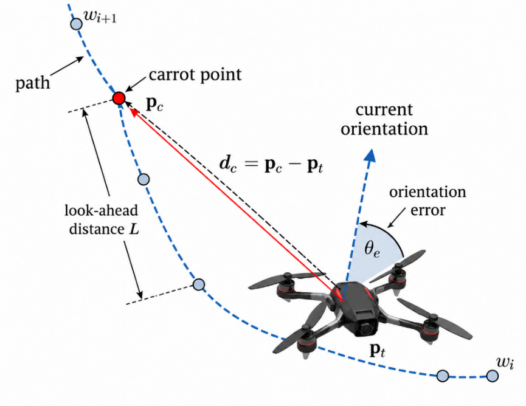

Fig. 3. Principle of the Carrot-Following path-following algorithm.

In this study, CF is implemented in ProjectAirSim to follow the same waypoint trajectory used for PPO evaluation. The CF reference-speed magnitude is set to $v_{ref}$ = 1.5 m/s. PPO and CF use the same helical trajectory, quadcopter configuration, and simulation environment. However, PPO constrains each velocity-command component to \[−3, 3\] m/s, whereas CF uses a fixed reference-speed magnitude of 1.5 m/s. Therefore, the completion-time results reflect the performance of the two controller configurations as implemented in this study and should not be interpreted as a speed-normalized comparison under an identical velocity limit. The tracking-error metrics are computed using the same rule for both methods.

4.  **Evaluation Metrics**

Control performance is evaluated from two primary perspectives: task-completion efficiency and trajectory-tracking accuracy. Completion time is used to characterize task execution speed, whereas RMSE and MAE quantify the deviation between the actual and reference trajectories. RMSE is more sensitive to large deviations, while MAE represents the average error magnitude over the complete tracking interval.

. Let $p_{k}$ denote the quadcopter position and $p_{k}^{ref}$ the closest point on the piecewise-linear path connecting the waypoints at the $k - th$ sample. The trajectory-tracking error is defined as$e_{k} = \text{|}p_{k} - p_{k}^{ref}\text{|}_{2}$. RMSE and MAE are calculated over the interval from the time the quadcopter reaches the first waypoint until it reaches the final waypoint. The same evaluation procedure is applied to both PPO and the reference method. The RMSE is defined as

$$
\text{RMSE} = \sqrt{\frac{1}{N}\sum_{k = 1}^{N}e_{k}^{2}},
\tag{11}
$$

whereas the MAE is calculated as

$$
\text{RMSE} = \sqrt{\frac{1}{N}\sum_{k = 1}^{N}e_{k}^{2}},
\tag{12}
$$

# RESULTS AND DISCUSSION

1.  **Result**

The results cover PPO training, post-training trajectory and attitude responses, and completion time and tracking errors over ten trials against CF. The PPO agent is trained for 500,000 interaction steps in ProjectAirSim (Fig. 4). Reward is initially low because the agent has not learned to approach and complete waypoints sequentially. It increases with training and, from approximately 350,000 steps, fluctuates within a higher-value region with smaller variations. This indicates progressive improvement in task-appropriate velocity commands. Without a separate quantitative convergence criterion, however, Fig. 4 does not establish mathematical convergence.

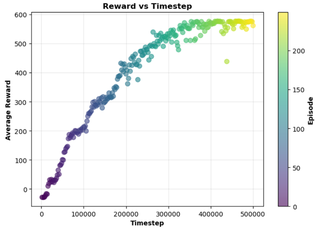

Fig. 4. Training results of the PPO agent.

After training, the PPO-agent weights are fixed and the agent is evaluated on a helical trajectory consisting of 40 waypoints with radius r = 1.5 m. In the NED frame, the z coordinate of the trajectory varies from −2.0 m at the initial point to −4.0 m at the final point. CF is used as the reference method. Both methods are evaluated on the same helical trajectory, with the same quadcopter configuration and simulation environment; each method is executed ten times under the same test scenario.

<table style="width:99%;">
<colgroup>
<col style="width: 49%" />
<col style="width: 49%" />
</colgroup>
<thead>
<tr>
<th style="text-align: center;">
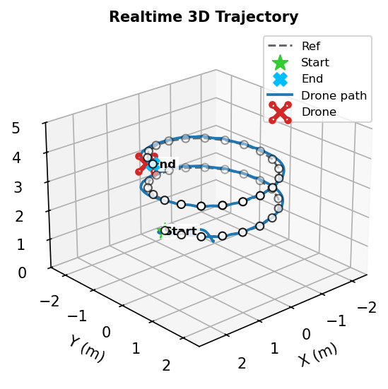

(a) PPO agent
</th>
<th style="text-align: center;">
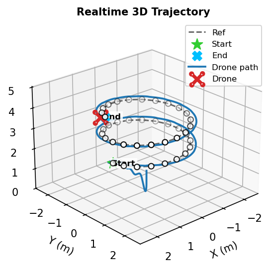

(b) CF
</th>
</tr>
</thead>
<tbody>
<tr>
<td colspan="2" style="text-align: center;">Fig. 5. Three-dimensional flight trajectories.</td>
</tr>
</tbody>
</table>

Fig. 5 shows that both methods complete the helical trajectory in the prescribed waypoint order. PPO remains relatively close to the reference path, with the largest deviations mainly where horizontal and vertical motion change simultaneously. CF exhibits larger deviations in several segments, consistent with Table II.

<table>
<colgroup>
<col style="width: 49%" />
<col style="width: 50%" />
</colgroup>
<thead>
<tr>
<th>
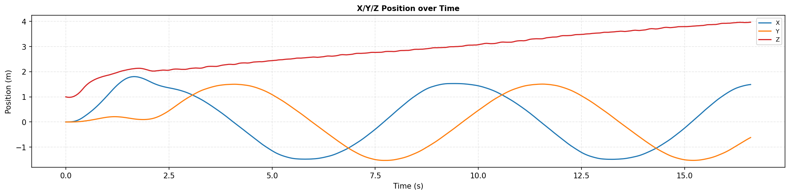

(a) PPO agent
</th>
<th>
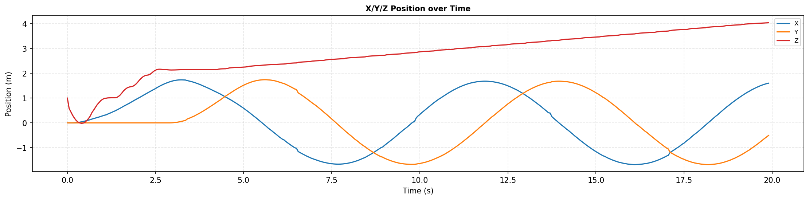

(b) CF
</th>
</tr>
</thead>
<tbody>
<tr>
<td colspan="2" style="text-align: center;">Fig. 6. Position responses.</td>
</tr>
</tbody>
</table>

Whereas Fig. 5 shows the three-dimensional trajectory shape, Fig. 6 presents the time histories of position to clarify the rate of progression along the trajectory. PPO completes the trajectory in less time than CF under the specified controller parameters. However, because CF uses $v_{ref} = 1.5m\text{/}s$ while PPO can generate each velocity component up to 3 m/s, the difference in completion time should not be attributed solely to an intrinsic advantage of the PPO policy. The timing results should be interpreted together with the tracking errors and the velocity constraints of the two methods.

<table>
<colgroup>
<col style="width: 49%" />
<col style="width: 50%" />
</colgroup>
<thead>
<tr>
<th>
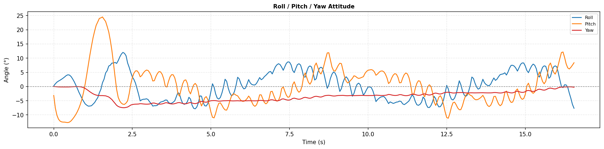

(a) PPO agent
</th>
<th>
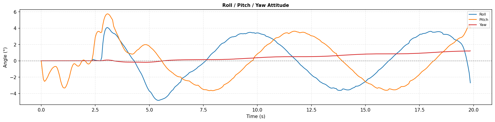

(b) CF
</th>
</tr>
</thead>
<tbody>
<tr>
<td colspan="2" style="text-align: center;">Fig. 7. Attitude responses</td>
</tr>
</tbody>
</table>

Fig. 7 shows larger PPO roll and pitch variations, particularly during direction changes, whereas CF produces smoother attitude responses with smaller amplitudes. Yaw remains relatively small for both methods. Thus, faster PPO motion is accompanied by greater attitude variation. Figs. 5–7 present representative runs; Table II reports individual results, means, and standard deviations from ten evaluations per method under the same scenario.

Table 2. Comparison of ppo and carrot-following results

| Trial | Method | $\mathbf{T}_{\mathbf{sim}\left( \mathbf{s} \right)}$ | RMSE (m) | MAE (m) | $\mathbf{RMS}\mathbf{E}_{\mathbf{x}}\left( \mathbf{m} \right)$ | $\mathbf{RMS}\mathbf{E}_{\mathbf{y}}\left( \mathbf{m} \right)$ | $\mathbf{RMS}\mathbf{E}_{\mathbf{z}}\left( \mathbf{m} \right)$ |
|:--:|:--:|:--:|:--:|:--:|:--:|:--:|:--:|
| 1 | CF | 24.96 | 0.200 | 0.197 | 0.131 | 0.134 | 0.071 |
|  | PPO | 16.83 | 0.083 | 0.073 | 0.054 | 0.048 | 0.041 |
| 2 | CF | 25.01 | 0.199 | 0.195 | 0.130 | 0.134 | 0.069 |
|  | PPO | 16.93 | 0.082 | 0.072 | 0.053 | 0.047 | 0.041 |
| 3 | CF | 25.03 | 0.198 | 0.195 | 0.130 | 0.134 | 0.067 |
|  | PPO | 16.93 | 0.082 | 0.072 | 0.053 | 0.047 | 0.040 |
| 4 | CF | 24.01 | 0.199 | 0.195 | 0.135 | 0.133 | 0.060 |
|  | PPO | 16.88 | 0.081 | 0.071 | 0.052 | 0.047 | 0.041 |
| 5 | CF | 24.11 | 0.195 | 0.191 | 0.130 | 0.133 | 0.058 |
|  | PPO | 16.93 | 0.081 | 0.072 | 0.052 | 0.047 | 0.041 |
| 6 | CF | 24.09 | 0.195 | 0.191 | 0.131 | 0.132 | 0.058 |
|  | PPO | 16.93 | 0.081 | 0.072 | 0.052 | 0.047 | 0.041 |
| 7 | CF | 25.00 | 0.199 | 0.195 | 0.130 | 0.134 | 0.070 |
|  | PPO | 16.88 | 0.082 | 0.072 | 0.053 | 0.047 | 0.041 |
| 8 | CF | 25.03 | 0.197 | 0.194 | 0.130 | 0.133 | 0.066 |
|  | PPO | 16.93 | 0.081 | 0.072 | 0.053 | 0.047 | 0.040 |
| 9 | CF | 24.11 | 0.194 | 0.191 | 0.130 | 0.132 | 0.058 |
|  | PPO | 16.88 | 0.082 | 0.072 | 0.053 | 0.047 | 0.041 |
| 10 | CF | 24.92 | 0.199 | 0.196 | 0.131 | 0.134 | 0.069 |
|  | PPO | 16.93 | 0.081 | 0.071 | 0.053 | 0.046 | 0.040 |
| Mean | CF | 24.63 | 0.198 | 0.194 | 0.131 | 0.133 | 0.065 |
|  | PPO | 16.91 | 0.082 | 0.072 | 0.053 | 0.047 | 0.041 |
| SD | CF | 0.47 | 0.002 | 0.002 | 0.001 | 0.001 | 0.005 |
|  | PPO | 0.04 | 0.001 | 0.001 | 0.001 | 0.000 | 0.000 |

In terms of completion time, PPO achieves a mean value of 16.91 s, compared with 24.63 s for CF, corresponding to a difference of approximately 31.3% under the controller configurations used. Because the two methods do not employ the same speed-magnitude limit, this result reflects only the completion times of the implemented configurations and should not be interpreted as a speed-normalized comparison. In terms of trajectory-tracking accuracy, PPO achieves a mean RMSE of 0.082 m and a mean MAE of 0.072 m, lower than the corresponding CF values of 0.198 m and 0.194 m; the respective reductions are approximately 58.6% and 62.9%. A similar trend is observed on each axis: the PPO RMSE_x, RMSE_y, and RMSE_z values are 0.053, 0.047, and 0.041 m, respectively, compared with 0.131, 0.133, and 0.065 m for CF. The corresponding reductions are approximately 59.5%, 64.7%, and 36.9%. Under the investigated conditions, PPO therefore maintains lower tracking errors than CF along all three axes.

In addition to the mean values, the standard deviations over ten trials indicate low variability in the PPO metrics. The standard deviation of completion time is 0.04 s for PPO, compared with 0.47 s for CF; the standard deviations of the PPO RMSE and MAE are both 0.001 m, whereas those of CF are 0.002 m. The standard-deviation values are rounded to the number of digits displayed in the table; consequently, values shown as 0.000 should not be interpreted as indicating absolutely zero variability across runs.

1.  **Dicussion**

PPO’s lower tracking errors may be associated with its state representation: the current-waypoint error defines the immediate target, while the next-waypoint error indicates the upcoming path direction. This information may help reduce deviations during waypoint transitions. On the helical trajectory, mean RMSE and MAE were 0.082 and 0.072 m for PPO, versus 0.198 and 0.194 m for CF. Without an ablation excluding next-waypoint information, however, its individual contribution cannot be quantified.

The reward design may also support tracking. Alongside completion and safety terms, the waypoint-approach reward encourages decreasing target distance and the velocity-alignment reward promotes target-directed motion. These continuous terms provide feedback before waypoint completion and reduce reward sparsity. The experiments assess the complete formulation; the contribution of each term requires an ablation study.

The lower PPO tracking errors are accompanied by larger roll and pitch variations during direction changes (Fig. 7), suggesting a trade-off between tracking performance and motion smoothness. PPO generates three independently bounded velocity components, whereas CF directs a fixed-magnitude velocity vector toward the carrot point. These differences may partly explain the attitude responses, but no dedicated command-smoothness or attitude-variation metrics were computed. The interpretation therefore remains observational; future evaluation should quantify command variation or attitude rates.

Velocity constraints also differ: CF uses a fixed speed magnitude of 1.5 m/s, while each PPO command component lies within \[−3, 3\] m/s. The mean completion times of 16.91 s and 24.63 s therefore describe the implemented configurations and do not establish an intrinsic PPO speed advantage. Equivalent velocity constraints are needed to isolate the control strategy’s effect on completion time.

Evaluation is limited to ProjectAirSim, one helical trajectory, and no explicitly introduced wind or model uncertainty. The repeated trials assess the fixed post-training controller in one scenario, not variability across PPO training seeds. The results support the framework’s feasibility rather than general superiority over conventional methods. Further evaluation should include different trajectory geometries, disturbances, model uncertainties, equivalent velocity constraints, and physical-quadcopter tests.

# CONCLUSION

This paper developed and evaluated a Proximal Policy Optimization (PPO) agent for quadcopter waypoint-trajectory tracking in the ProjectAirSim environment. The agent uses a 15-dimensional state vector, comprising the quadcopter motion state and relative errors to the current and next waypoints, to generate velocity commands along the three axes of the North–East–Down frame. The reward function consists of four components that promote waypoint completion, discourage unsafe states, encourage progress toward the target, and maintain the velocity direction toward the waypoint.

After 500,000 training interaction steps, the PPO weights were fixed and evaluated on a helical trajectory consisting of 40 waypoints. The Carrot-Following (CF) algorithm was used as the reference method; both methods were tested on the same trajectory, with the same quadcopter configuration and simulation environment, using ten repeated evaluation runs for each method.

The results show that both PPO and CF complete the prescribed trajectory. PPO achieves a mean completion time of 16.91 s compared with 24.63 s for CF; however, because CF uses a fixed reference speed of 1.5 m/s while PPO allows each velocity-command component to reach 3 m/s, the completion-time difference reflects the adopted controller configurations rather than a comparison under identical velocity limits. In terms of tracking accuracy, PPO achieves mean RMSE and MAE values of 0.082 and 0.072 m, respectively, corresponding to reductions of 58.6% and 62.9% relative to CF under the investigated conditions. The PPO RMSE values along the x, y, and z axes are 0.053, 0.047, and 0.041 m, respectively.

In addition to the lower tracking errors, the PPO metrics exhibit low variability over the ten trials. However, the PPO roll and pitch responses vary more strongly than those of CF at several direction-change instants along the helical trajectory, indicating that tracking accuracy and response speed should be considered together with motion smoothness.

Overall, within the investigated simulation environment and scenarios, the results demonstrate the feasibility of a PPO policy that generates high-level velocity commands for waypoint-trajectory tracking. Future work should evaluate the policy on a wider range of trajectories and disturbance conditions, consider equivalent velocity-limit configurations for the compared methods, and incorporate criteria related to control-command smoothness and attitude response.

# REFERENCES

1.  M. F. Ahmed, J. C. Mohanta, and M. N. Zafar, “Development of smart quadcopter for autonomous overhead power transmission line inspections,” Mater. Today Proc., vol. 51, pp. 261–268, 2022, doi: 10.1016/j.matpr.2021.05.271.

2.  K. Karam, A. Mansour, M. Khaldi, B. Clement, and M. Ammad Uddin, “Quadcopters in Smart Agriculture: Applications and Mod elling,” Appl. Sci., vol. 14, no. 19, Art. no. 9132, Oct. 2024, doi: 10.3390/app14199132.

3.  Martinez-Alpiste, G. Golcarenarenji, Q. Wang, and J. M. Alcaraz Calero, “Search and rescue operation using UAVs: A case study,” Expert Syst. Appl., vol. 178, Art. no. 114937, Sep. 2021, doi: 10.1016/j.eswa.2021.114937.

4.  M. A. Abitha and A. Saleem, “Quadrotor Modeling Approaches and Tra jectory Tracking Control Algorithms: A Review,” International Journal of Robotics and Control Systems, vol. 4, no. 1, pp. 401–426, Apr. 2024, doi: 10.31763/ijrcs.v4i1.1324.

5.  Abdulkareem, V. Oguntosin, O. M. Popoola, and A. A. Idowu, “Modeling and Nonlinear Control of a Quadcopter for Stabilization and Trajectory Tracking,” J. Eng., vol. 2022, pp. 1–19, Oct. 2022, doi: 10.1155/2022/2449901.

6.  M. Rabah, A. Rohan, Y.-J. Han, and S.-H. Kim, “Design of Fuzzy-PID Controller for Quadcopter Trajectory-Tracking,” International Journal of Fuzzy Logic and Intelligent Systems, vol. 18, no. 3, pp. 204–213, Sep. 2018, doi: 10.5391/IJFIS.2018.18.3.204.

7.  L. Martins, C. Cardeira, and P. Oliveira, “Linear Quadratic Regulator for Trajectory Tracking of a Quadrotor,” IFAC-PapersOnLine, vol. 52, no. 12, pp. 176–181, 2019, doi: 10.1016/j.ifacol.2019.11.195.

8.  D. Rodriguez-Guevara, A. Favela-Contreras, and O. J. Gonzalez Villarreal, “A qLPV-MPC Control Strategy for Trajectory Tracking of Quadrotors,” Machines, vol. 11, no. 7, Art. no. 755, Jul. 2023, doi: 10.3390/machines11070755.

9.  D. J. Almakhles, “Robust Backstepping Sliding Mode Control for a Quadrotor Trajectory Tracking Application,” IEEE Access, vol. 8, pp. 5515–5525, 2020, doi: 10.1109/ACCESS.2019.2962722.

10. E. J. J. Smeur, G. C. H. E. De Croon, and Q. Chu, “Cascaded incremental nonlinear dynamic inversion for MAV disturbance re jection,” Control Eng. Pract., vol. 73, pp. 79–90, Apr. 2018, doi: 10.1016/j.conengprac.2018.01.003.

11. Q. N. Duong and N. T. Dang, “Model-free Optimal Control for Un deractuated Quadrotor Aircraft via Reinforcement Learning,” Journal of Robotics and Control (JRC), vol. 5, no. 6, pp. 1827–1835, Sep. 2024, doi: 10.18196/jrc.v5i6.23585.

12. P. Caffyn Yuste, J. A. Iglesias Martínez, and M. A. Sanchis De Miguel, “Simulation-based evaluation of model-free reinforcement learning algorithms for quadcopter attitude control and trajectory track ing,” Neurocomputing, vol. 608, Art. no. 128362, Dec. 2024, doi: 10.1016/j.neucom.2024.128362.

13. T. Y. Trad et al., “Real-Time Implementation of Quadrotor UAV Control System Based on a Deep Reinforcement Learning Approach,” Comput. Mater. Continua, vol. 81, no. 3, pp. 4757–4786, 2024, doi: 10.32604/cmc.2024.055634.

14. J. Wu, Z. Yang, L. Liao, N. He, Z. Wang, and C. Wang, “A State Compensated Deep Deterministic Policy Gradient Algorithm for UAV Trajectory Tracking,” Machines, vol. 10, no. 7, Art. no. 496, Jun. 2022, doi: 10.3390/machines10070496.

15. H. Liu, S. Suzuki, W. Wang, H. Liu, and Q. Wang, “Robust Control Strategy for Quadrotor Drone Using Reference Model-Based Deep Deterministic Policy Gradient,” Drones, vol. 6, no. 9, Art. no. 251, Sep. 2022, doi: 10.3390/drones6090251.

16. Y. Mahran, Z. Gamal, and A. El-Badawy, “Reinforcement Learning Position Control of a Quadrotor Using Soft Actor-Critic (SAC),” in Proc. 6th Novel Intell. Leading Emerging Sci. Conf. (NILES), Oct. 2024, pp. 72–75, doi: 10.1109/NILES63360.2024.10753187.

17. T. P. Lillicrap et al., “Continuous Control with Deep Reinforcement Learning,” in Proc. Int. Conf. Learn. Represent. (ICLR), San Juan, Puerto Rico, May 2016.

18. S. Fujimoto, H. van Hoof, and D. Meger, “Addressing Function Approx imation Error in Actor-Critic Methods,” in Proc. 35th Int. Conf. Mach. Learn. (ICML), Stockholm, Sweden, Jul. 2018, pp. 1587–1596.

19. T. Haarnoja, A. Zhou, P. Abbeel, and S. Levine, “Soft Actor-Critic: Off-Policy Maximum Entropy Deep Reinforcement Learning with a Stochastic Actor,” in Proc. 35th Int. Conf. Mach. Learn. (ICML), Stockholm, Sweden, Jul. 2018, pp. 1861–1870.

20. J. Schulman, F. Wolski, P. Dhariwal, A. Radford, and O. Klimov, “Prox imal Policy Optimization Algorithms,” arXiv:1707.06347, Jul. 2017.

21. H. Pérez-León, J. J. Acevedo, J. A. Millán-Romera, A. Castillejo-Calle, I. Maza, and A. Ollero, “An Aerial Robot Path Follower Based on the ‘Carrot Chasing’ Algorithm,” in Robot 2019: Fourth Iberian Robotics Conference, Advances in Intelligent Systems and Computing, vol. 1092, Springer, 2020, pp. 37–47
