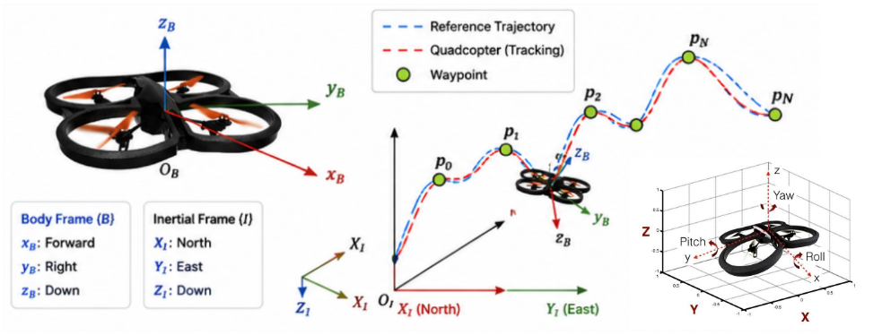

# 2. PROBLEM FORMULATION

The control objective is to drive the quadcopter sequentially through the waypoint set $W = \text{\{}w_{1},\ldots,w_{N}\text{\}}$, as illustrated in Fig. 1, in three-dimensional space. The i-th waypoint, $w_{i} = \left\lbrack x_{i},y_{i},z_{i} \right\rbrack^{T}$, and the quadcopter position at time t, $p_{t} = \left\lbrack x_{t},y_{t},z_{t} \right\rbrack^{T}$, are both expressed in the inertial North–East–Down (NED) frame.

Fig. 1. Quadcopter waypoint trajectory-tracking problem formulation.

As shown in Fig. 1, quadcopter motion is described using two coordinate frames: the inertial frame {I} and the body-fixed frame {B}. The inertial frame describes the vehicle position and flight trajectory in the global space, where the $X_{I},Y_{I}$, and $Z_{I}$ axes correspond to the North, East, and Down directions, respectively. The body-fixed frame is attached to the quadcopter and consists of the $x_{B}$, $y_{B}$, and $z_{B}$ axes, which describe the vehicle motion direction and attitude. At each control instant, one waypoint is designated as the current target. Once the waypoint-completion condition is satisfied, the target is switched to the next waypoint until the entire waypoint sequence has been completed. The control problem is therefore to construct a policy capable of guiding the quadcopter through the waypoint sequence in the prescribed order while maintaining safe flight, reducing trajectory-tracking error, and shortening the completion time subject to the specified control constraints.
