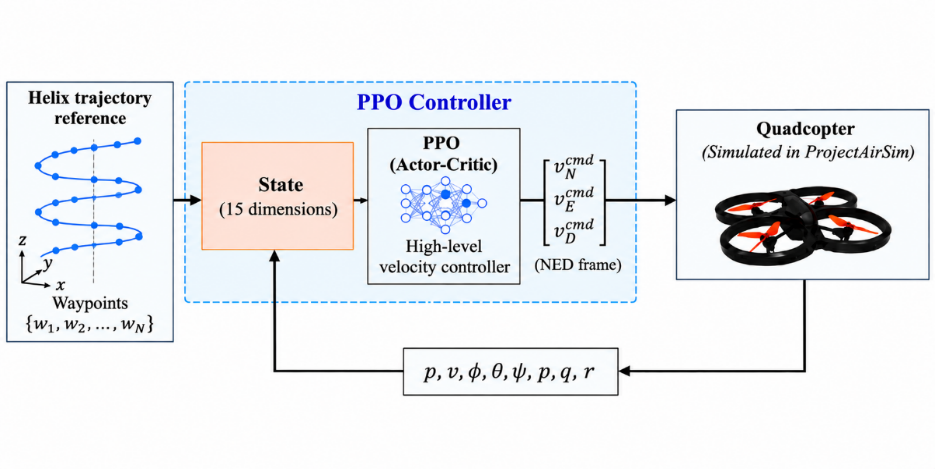

# PPO-BASED CONTROLLER DESIGN

Fig. 2 shows the hierarchical control architecture. The PPO agent uses the quadcopter state and reference-trajectory information to generate NED velocity commands, which are executed by the low-level flight-control loops in ProjectAirSim \[23\]. Position, velocity, Euler angles, and angular velocity are fed back to form a closed-loop system. Agent design comprises the state space, action space, reward function, and an Actor–Critic network that learns the state-to-command mapping.

Fig. 2. Control architecture for quadcopter trajectory tracking.

## State Space Design

The state space combines trajectory geometry, translational motion, and attitude information. The current-waypoint error specifies the immediate target, while the next-waypoint error indicates the local trajectory direction and supports velocity adjustment between waypoints. The resulting state is the following 15-dimensional vector:

$$
s_{t} = \left\lbrack d_{x}^{i},d_{y}^{i},d_{z}^{i},d_{x}^{i + 1},d_{y}^{i + 1},d_{z}^{i + 1},v_{x},v_{y},v_{z},\phi,\theta,\psi,\dot{\phi},\dot{\theta},\dot{\psi} \right\rbrack^{\text{T}}
\tag{1}
$$

where:

- $d_{x}^{i},d_{y}^{i},d_{z}^{i}$i are the components of the relative position-error vector from the quadcopter to the ith waypoint along the three axes of the NED (North–East–Down) frame, defined by

$$
d_{i} = \omega_{i} - p_{t}
\tag{2}
$$

> where $p_{t} = \lbrack x,y,z\rbrack^{T} \in R^{\mathbb{3}}$ denotes the quadcopter position at time $t$, and $\omega_{i} = \left\lbrack x_{w},y_{w},z_{w} \right\rbrack^{T} \in R^{\mathbb{3}}\ $denotes the position of the $i - th$ waypoint;

- $d_{x}^{i + 1},d_{y}^{i + 1},d_{z}^{i + 1}$ are the components of the relative position-error vector from the quadcopter to the $(i + 1) - th$ waypoint;

- $v_{x},v_{y},v_{z}\ $are the components of the quadcopter linear velocity along the three coordinate axes;

- $\phi,\ \theta,\ \psi$ denote the roll, pitch, and yaw angles, respectively, describing the quadcopter attitude at time $t$;

- $\dot{\phi},\dot{\theta},\ \dot{\psi}$ denote the angular velocities about the roll, pitch, and yaw axes, respectively.

## Action Space Design

The PPO agent provides high-level guidance through velocity commands, while the flight controller retains the dynamic-stabilization loops. The continuous action space therefore comprises three components:

$$
a_{t} = \left\lbrack v_{N}^{\text{cmd}},v_{E}^{\text{cmd}},v_{D}^{\text{cmd}} \right\rbrack^{\text{T}}
\tag{3}
$$

where $v_{N}^{\text{cmd}},v_{E}^{\text{cmd}},v_{D}^{\text{cmd}}$ denote the commanded velocities along the North, East, and Down axes of the NED coordinate frame, respectively. The three action components correspond to the desired velocity commands in the North, East, and Down directions of the NED frame. The PPO policy does not directly issue thrust, control-moment, or individual-rotor-speed commands; instead, the velocity commands are passed to the flight controller integrated in ProjectAirSim for attitude stabilization and conversion into low-level control actions. Accordingly, PPO is treated as a high-level velocity-command policy. To ensure that the control signals remain within a suitable range, each action component is constrained by

$$
v_{N}^{\text{cmd}},v_{E}^{\text{cmd}},v_{D}^{\text{cmd}} \in \lbrack - 3.0,3.0\rbrack\,\text{m/s}
\tag{4}
$$

This constraint is implemented using the Box class of the Gymnasium library \[24\], ensuring that the velocity commands generated by the agent do not exceed the specified range during training and testing. Interactions between the PPO agent and the simulation environment are executed in lock-step mode with a fixed time step Δt = 0.05 s, corresponding to a control frequency $f_{c} = 1\text{/}\Delta t = 20\,\text{Hz}$.

## Reward Function Design

The reward function promotes waypoint completion and safe flight while providing continuous feedback between waypoints. To reduce the sparsity of a completion-only reward, waypoint-approach and velocity-alignment terms are combined with the completion reward and safety penalty:

$$
R_{sum} = r_{waypoint} + r_{penalty} + r_{approach} + r_{align}
\tag{5}
$$

where:

- $R_{\text{sum}}$ is the total reward at time t;

- $r_{\text{waypoint}}$ and $r_{\text{penalty}}$ are the reward for waypoint completion and the penalty for violating a safety condition, respectively;

- $r_{\text{approach}}$ is the waypoint-approach reward, which encourages the quadcopter to reduce its distance to the current waypoint;

- $r_{\text{align}}$ is a continuous reward that encourages the quadcopter to maintain a velocity direction aligned with the direction from its current position to the waypoint..

**Waypoint-Completion Reward**

To encourage the quadcopter to complete the waypoints in the prescribed order along the reference trajectory, the reward is defined as follows:

$$
r_{waypoint} = \left\{ \begin{array}{r}
10\ if\ d\left( p_{t},w_{i} \right) < \epsilon\ and\ i < n\  \\
15 + 15*\frac{T_{\max} - t}{T_{\max}}\ \ \ if\ d\left( p_{t},w_{i} \right) < \epsilon\ and\ i = n\  \\
0\ otherwise
\end{array} \right.\
\tag{6}
$$

where $p_{t} \in R^{\mathbb{3}}$is the quadcopter position at time t, $\omega_{i} \in R^{\mathbb{3}}$ is the $i - th$ waypoint, $T_{\max}$ is the maximum number of steps in an episode, $r_{w} = 0.2\ m$ is the radius used to determine waypoint completion, and $\left( p_{t},\omega_{i} \right) = \text{|}p_{t} - \omega_{i}\text{|}_{2}$ is the Euclidean distance between the quadcopter and the target waypoint. The target waypoint is considered reached when $d\left( p_{t},\omega_{i} \right) < r_{w}$. Upon reaching an intermediate waypoint, the agent receives a positive reward. If the final waypoint is completed before the maximum number of episode steps is reached, the agent receives an additional reward that depends on the number of remaining time steps.

**Safety-Violation Penalty**

At each time step, if the episode terminates prematurely because the quadcopter collides with the ground, overturns, or moves excessively far from the target waypoint, the agent receives a large negative penalty:

$$
r_{\text{penalty}} = - 30
\tag{7}
$$

This mechanism acts as a safety constraint that encourages the quadcopter to avoid hazardous conditions, such as ground collisions, excessive roll or pitch angles $|\phi|$ or $|\theta| > \pi\text{/}2$, or excessive deviation from the target waypoint. Applying the same large penalty to these hazardous events emphasizes that any condition leading to premature episode termination is undesirable and should be avoided during flight. If no hazardous event occurs, the training process proceeds to evaluate the waypoint-completion condition.

**Waypoint-Approach Reward**

The waypoint-approach reward $r_{\text{approach}}$ is defined as

$$
r_{approach} = max\left\lbrack 0\ ,\ 5.0*\left( d(p_{t - 1},\omega_{i}) - d(p_{t},\omega_{i}) \right) \right\rbrack
\tag{8}
$$

where $d\left( p_{t - 1},\omega_{i} \right)$ and $d\left( p_{t},\omega_{i} \right)\ $denote the distances from the quadcopter to the $i - th$ waypoint at time steps $t - 1$ and $t$, respectively. This reward is designed to encourage the quadcopter to reduce its distance to the current waypoint at each time step. Accordingly, the agent receives a positive reward when the distance to the current waypoint decreases relative to the previous time step; otherwise, the reward is zero when the quadcopter does not move closer to the waypoint.

**Velocity-Alignment Reward**

The velocity-alignment reward $r_{\text{align}}$ encourages the quadcopter to maintain its direction of motion aligned with the direction from its current position toward the target waypoint. It is defined as

$$
r_{align} = \max\left( 0,0.2 \cdot v_{t} \cdot \frac{\omega_{i} - p_{t}}{d\left( p_{t},w_{i} \right)} \right)
\tag{9}
$$

where $v_{t} \in R^{\mathbb{3}}$ denotes the linear velocity vector of the quadcopter at time $t$. The reward is determined by the dot product between the velocity vector and the unit vector pointing toward the target waypoint. This component takes a positive value when the velocity vector has a component directed toward the waypoint, corresponding to an angle of less than $90^{\circ}$ between the two vectors. When the quadcopter moves perpendicular to or away from the waypoint, the reward is zero.

## Actor-Critic Network

With the state and action spaces defined, the policy-learning problem can be formulated as a mapping from the 15-dimensional state vector to three velocity commands in the NED frame. This mapping is learned using the Proximal Policy Optimization (PPO) algorithm \[20\] with an Actor–Critic architecture. The Actor network maps the current quadcopter state to the desired velocity command, whereas the Critic network estimates the state value to support policy updates. Both the Actor and Critic take the state vector $s_{t} \in R^{15}$ defined in Section 3.1 as input. Before being fed to the networks, the state components are normalized to reduce the effect of scale differences among the observed variables. Each network contains two fully connected hidden layers, each with 64 neurons and a Tanh activation function.
