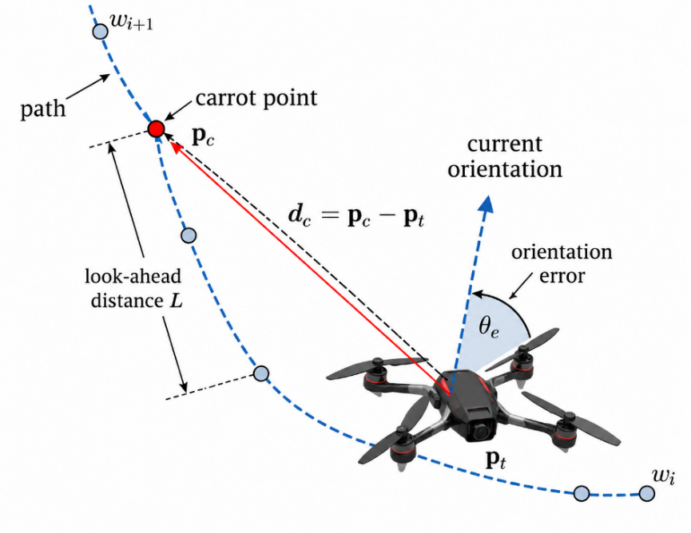

# SIMULATION SETUP AND EXPERIMENTAL PARAMETERS

The simulation comprises PPO training and evaluation with fixed learned weights. Trajectory completion, completion time, and tracking error are assessed against Carrot-Following (CF) \[21\] in the same environment.

1.  **Simulation Environment**

The PPO agent is trained and evaluated in the ProjectAirSim simulation environment. This environment provides a real-time physics model of the quadcopter, enabling simulation of vehicle motion states, sensors, and dynamic interactions in three-dimensional space. In the simulation, the quadcopter has an X configuration with a body mass of approximately 1.0 kg. The propulsion system consists of four symmetrically arranged rotors with a 0.253-m spacing along the two body axes. Each rotor has a diameter of 0.2286 m and a maximum rotational speed of approximately 6396 r/min. Two rotors rotate clockwise and two counterclockwise to balance the overall reaction torque. The aerodynamic and lift parameters are specified according to the ProjectAirSim simulation configuration.

2.  **PPO Training Parameters**

The main training parameters of the PPO controller are summarized in Table I.

Table I. PPO training parameters

| **Parameter** | **Value** |
|:--|:--|
| Total training timesteps | 500,000 |
| Maximum timesteps per episode | 400 |
| Control period, $\Delta t$ | 0.05 s |
| PPO update interval | 2000 timesteps |
| Actor learning rate | $3 \times 10^{- 4}$ |
| Critic learning rate | $1 \times 10^{- 3}$ |
| Number of update epochs, K | 5 |
| Discount factor, $\gamma$ | 0.99 |
| GAE parameter, $\lambda$ | 0.95 |
| Clipping parameter, $\epsilon$ | 0.2 |
| Initial action standard deviation | 1.0 |
| Minimum action standard deviation | 0.1 |
| Action standard-deviation decay step | 0.01 |
| Action standard-deviation decay interval | 50 episodes |
| Number of neurons per hidden layer | 64 |
| Number of hidden layers in Actor/Critic | 2 |
| Activation function | Tanh |

3.  **Reference Method**

Carrot-Following (CF) is the reference method. This look-ahead algorithm guides the quadcopter toward a carrot point ahead on the reference path rather than only toward the next waypoint (Fig. 3).

Let $p_{t}$ denote the current quadcopter position and $p_{c}$ the carrot-point position on the reference path. The carrot point is selected at a look-ahead distance L ahead of the current progress position along the path. The direction vector from the quadcopter to the carrot point is then given by

$$
d_{c} = p_{c} - p_{t}
\tag{10}
$$

From this vector, the desired velocity direction is defined from the current quadcopter position toward the carrot point. For a reference speed magnitude v_ref, the CF velocity vector is expressed as

$$
v_{CF} = v_{ref}\left( p_{c} - p_{t} \right)\text{/}\left| \left| p_{c} - p_{t} \right| \right|^{2}
\tag{11}
$$

As the quadcopter moves, its progress position on the reference path is continuously updated and the carrot point advances along the path. Consequently, the direction of $v_{CF}$ is adjusted according to the local path geometry. The look-ahead mechanism provides a continuous transition between consecutive waypoint segments. Fig. 3 illustrates the heading-error angle $\theta_{e}$ between the current motion direction and the direction to the carrot point; this quantity is used to illustrate the geometric relationship in the path-following process, whereas the velocity-generation law used in this study is defined by the vector from the current position to the carrot point, as given in (11).

Fig. 3. Principle of the Carrot-Following path-following algorithm.

In this study, CF is implemented in ProjectAirSim to follow the same waypoint trajectory used for PPO evaluation. The CF reference-speed magnitude is set to $v_{ref}$ = 1.5 m/s. PPO and CF use the same helical trajectory, quadcopter configuration, and simulation environment. However, PPO constrains each velocity-command component to \[−3, 3\] m/s, whereas CF uses a fixed reference-speed magnitude of 1.5 m/s. Therefore, the completion-time results reflect the performance of the two controller configurations as implemented in this study and should not be interpreted as a speed-normalized comparison under an identical velocity limit. The tracking-error metrics are computed using the same rule for both methods.

4.  **Evaluation Metrics**

Control performance is evaluated from two primary perspectives: task-completion efficiency and trajectory-tracking accuracy. Completion time is used to characterize task execution speed, whereas RMSE and MAE quantify the deviation between the actual and reference trajectories. RMSE is more sensitive to large deviations, while MAE represents the average error magnitude over the complete tracking interval.

. Let $p_{k}$ denote the quadcopter position and $p_{k}^{ref}$ the closest point on the piecewise-linear path connecting the waypoints at the $k - th$ sample. The trajectory-tracking error is defined as$e_{k} = \text{|}p_{k} - p_{k}^{ref}\text{|}_{2}$. RMSE and MAE are calculated over the interval from the time the quadcopter reaches the first waypoint until it reaches the final waypoint. The same evaluation procedure is applied to both PPO and the reference method. The RMSE is defined as

$$
\text{RMSE} = \sqrt{\frac{1}{N}\sum_{k = 1}^{N}e_{k}^{2}},
\tag{11}
$$

whereas the MAE is calculated as

$$
\text{RMSE} = \sqrt{\frac{1}{N}\sum_{k = 1}^{N}e_{k}^{2}},
\tag{12}
$$
