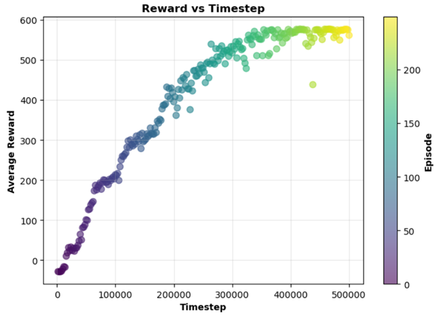
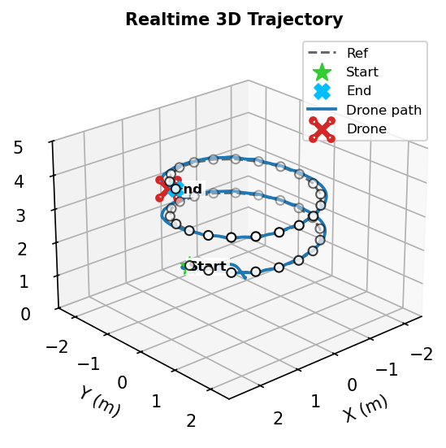
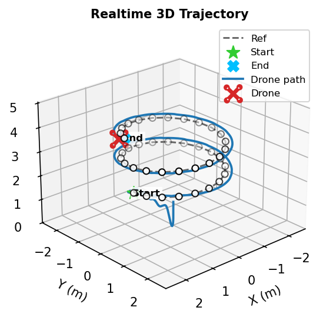
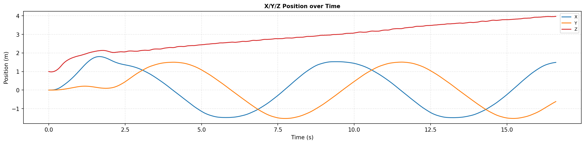
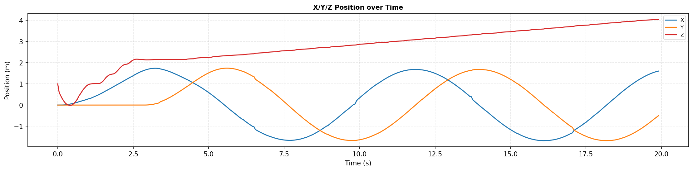
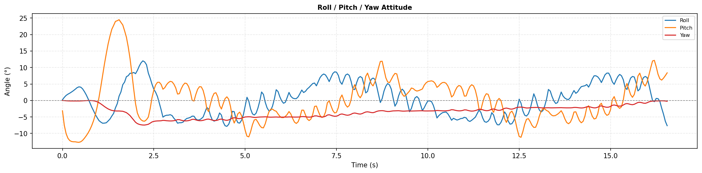
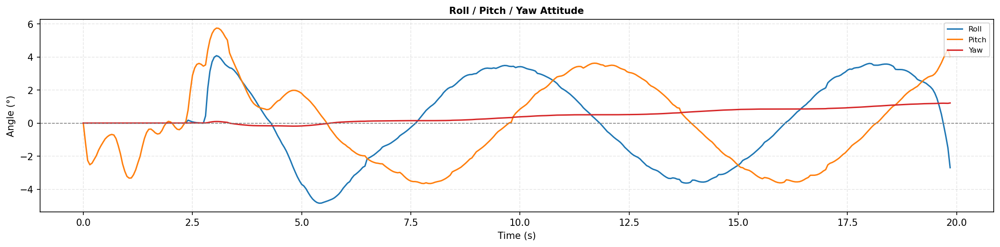

# RESULTS AND DISCUSSION

1.  **Results**

Proximal Policy Optimization was trained for 500,000 ProjectAirSim interaction steps (Fig. 4). Reward is initially low because the policy has not learned sequential waypoint completion, then increases and fluctuates within a higher range after approximately 350,000 steps. This pattern indicates improved training return under the adopted configuration. Because no quantitative convergence criterion was used, Fig. 4 does not prove mathematical convergence or show that further training could not alter the policy.

Fig. 4. Training results of the PPO agent.

After training, the policy parameters were frozen. The learned controller and CF were each evaluated ten times on the same helical trajectory, quadcopter, and nominal simulation configuration. These repetitions characterize fixed-controller consistency, not sensitivity to independent training initialization.

<table style="width:99%;">
<colgroup>
<col style="width: 49%" />
<col style="width: 49%" />
</colgroup>
<thead>
<tr>
<th style="text-align: center;">

(a) PPO agent
</th>
<th style="text-align: center;">

(b) CF
</th>
</tr>
</thead>
<tbody>
<tr>
<td colspan="2" style="text-align: center;">Fig. 5. Three-dimensional flight trajectories.</td>
</tr>
</tbody>
</table>

Both methods completed the waypoints in order (Fig. 5). The learned policy remains close to the reference over most of the helix, with its largest visible deviations where horizontal and vertical motion change simultaneously. CF follows the overall geometry but has larger offsets in several segments, consistent with the aggregate values in Table II. The plots show representative runs; trial-to-trial variation is reported by the table.

<table>
<colgroup>
<col style="width: 49%" />
<col style="width: 50%" />
</colgroup>
<thead>
<tr>
<th>

(a) PPO agent
</th>
<th>

(b) CF
</th>
</tr>
</thead>
<tbody>
<tr>
<td colspan="2" style="text-align: center;">Fig. 6. Position responses.</td>
</tr>
</tbody>
</table>

Fig. 6 presents position over time and shows faster trajectory progression by the learned policy under the tested settings. CF used $L=0.5$ m and $v_{ref}=1.5m\text{/}s$, whereas the learned policy could use each component up to 3 m/s. Despite common component-wise bounds, the operating speeds were not normalized. The timing difference therefore describes the implemented configurations and is not an intrinsic advantage of the learning algorithm.

<table>
<colgroup>
<col style="width: 49%" />
<col style="width: 50%" />
</colgroup>
<thead>
<tr>
<th>

(a) PPO agent
</th>
<th>

(b) CF
</th>
</tr>
</thead>
<tbody>
<tr>
<td colspan="2" style="text-align: center;">Fig. 7. Attitude responses.</td>
</tr>
</tbody>
</table>

The learned policy produced larger roll and pitch variations during direction changes, whereas CF was smoother; yaw remained small for both methods (Fig. 7). Thus, lower geometric trajectory error did not imply a smoother attitude response. Figs. 5–7 are representative runs, while Table II reports all ten evaluations per method.

Table II. Comparison of PPO and Carrot-Following results.

| Trial | Method | $\mathbf{T}_{\mathbf{sim}\left( \mathbf{s} \right)}$ | RMSE (m) | MAE (m) | $\mathbf{RMS}\mathbf{E}_{\mathbf{x}}\left( \mathbf{m} \right)$ | $\mathbf{RMS}\mathbf{E}_{\mathbf{y}}\left( \mathbf{m} \right)$ | $\mathbf{RMS}\mathbf{E}_{\mathbf{z}}\left( \mathbf{m} \right)$ |
|:--:|:--:|:--:|:--:|:--:|:--:|:--:|:--:|
| 1 | CF | 24.96 | 0.200 | 0.197 | 0.131 | 0.134 | 0.071 |
|  | PPO | 16.83 | 0.083 | 0.073 | 0.054 | 0.048 | 0.041 |
| 2 | CF | 25.01 | 0.199 | 0.195 | 0.130 | 0.134 | 0.069 |
|  | PPO | 16.93 | 0.082 | 0.072 | 0.053 | 0.047 | 0.041 |
| 3 | CF | 25.03 | 0.198 | 0.195 | 0.130 | 0.134 | 0.067 |
|  | PPO | 16.93 | 0.082 | 0.072 | 0.053 | 0.047 | 0.040 |
| 4 | CF | 24.01 | 0.199 | 0.195 | 0.135 | 0.133 | 0.060 |
|  | PPO | 16.88 | 0.081 | 0.071 | 0.052 | 0.047 | 0.041 |
| 5 | CF | 24.11 | 0.195 | 0.191 | 0.130 | 0.133 | 0.058 |
|  | PPO | 16.93 | 0.081 | 0.072 | 0.052 | 0.047 | 0.041 |
| 6 | CF | 24.09 | 0.195 | 0.191 | 0.131 | 0.132 | 0.058 |
|  | PPO | 16.93 | 0.081 | 0.072 | 0.052 | 0.047 | 0.041 |
| 7 | CF | 25.00 | 0.199 | 0.195 | 0.130 | 0.134 | 0.070 |
|  | PPO | 16.88 | 0.082 | 0.072 | 0.053 | 0.047 | 0.041 |
| 8 | CF | 25.03 | 0.197 | 0.194 | 0.130 | 0.133 | 0.066 |
|  | PPO | 16.93 | 0.081 | 0.072 | 0.053 | 0.047 | 0.040 |
| 9 | CF | 24.11 | 0.194 | 0.191 | 0.130 | 0.132 | 0.058 |
|  | PPO | 16.88 | 0.082 | 0.072 | 0.053 | 0.047 | 0.041 |
| 10 | CF | 24.92 | 0.199 | 0.196 | 0.131 | 0.134 | 0.069 |
|  | PPO | 16.93 | 0.081 | 0.071 | 0.053 | 0.046 | 0.040 |
| Mean | CF | 24.63 | 0.198 | 0.194 | 0.131 | 0.133 | 0.065 |
|  | PPO | 16.91 | 0.082 | 0.072 | 0.053 | 0.047 | 0.041 |
| SD | CF | 0.47 | 0.002 | 0.002 | 0.001 | 0.001 | 0.005 |
|  | PPO | 0.04 | 0.001 | 0.001 | 0.001 | 0.000 | 0.000 |

Mean completion times were 16.91 s for PPO and 24.63 s for CF, corresponding to a 31.3% difference under the implemented controller configurations. This numerical comparison is retained because it describes the observed task durations, but its interpretation is limited by the different speed specifications. CF retained a 1.5-m/s reference magnitude, while the learned controller generated independently bounded velocity components. The result is therefore not a speed-normalized comparison and cannot attribute the entire difference to the controller type.

For geometric trajectory deviation, PPO achieved mean root-mean-square and mean absolute errors of 0.082 and 0.072 m, compared with 0.198 and 0.194 m for CF. These values correspond to reductions of 58.6% and 62.9% under the tested configuration. The same trend appears in the individual axes. PPO's root-mean-square errors in the $x$, $y$, and $z$ directions were 0.053, 0.047, and 0.041 m, respectively, compared with 0.131, 0.133, and 0.065 m for CF. The corresponding reductions were 59.5%, 64.7%, and 36.9%. Because the reference point for each sample is the closest point on the waypoint polyline, these values quantify spatial proximity to the trajectory geometry; they do not measure whether the vehicle and a timed reference reached corresponding locations simultaneously.

Across ten fixed-controller evaluations, the completion-time standard deviation was 0.04 s for PPO and 0.47 s for CF. Root-mean-square and mean absolute error standard deviations were 0.001 m for PPO and 0.002 m for CF. These values describe nominal repeated execution, not independently trained policies. Values displayed as 0.000 after rounding do not imply exactly zero variation.

2.  **Discussion**

The lower geometric errors obtained by PPO may be associated with the information included in its state representation. The current-waypoint error identifies the immediate target, while the next-waypoint error provides information about the upcoming segment. This combination can make a change in local trajectory direction observable before the current target is completed. Nevertheless, the complete state was used throughout training and evaluation. Without an otherwise identical experiment that removes the next-waypoint components, the specific contribution of those inputs cannot be separated from the effects of the remaining state variables, the reward, and the learned policy.

The approach and alignment rewards provide feedback between discrete waypoint completions. The first is positive when the target distance decreases from one step to the next, and the second is positive when the current velocity has a component toward the waypoint. Together, they make task-related feedback available more frequently than a completion-only formulation. The experiment, however, evaluates only the complete four-term reward. No training runs remove or rescale individual terms, so their separate contributions and the sensitivity to the fixed coefficients remain unquantified.

Lower PPO trajectory deviation coincided with larger visible roll and pitch variations, suggesting a possible trade-off between spatial tracking and motion smoothness. The learned controller generated three independently bounded velocity components, whereas CF directed a fixed-magnitude velocity vector toward a look-ahead point. The controllers also progressed at different rates, which can affect the attitude changes needed to redirect the vehicle. These distinctions offer plausible context for the plotted responses but do not establish a causal explanation. No command-variation, attitude-rate, or smoothness metric was computed, so the comparison remains observational.

The training objective itself also affects the interpretation of task duration. The 400-step episode limit bounds the available time, and the final-waypoint reward increases with the number of remaining steps. The learned policy is therefore explicitly encouraged to complete the sequence early. Combined with CF's fixed 1.5-m/s reference speed and the learned policy's independently bounded components, these design choices prevent attribution of the completion-time difference to Proximal Policy Optimization alone. A controlled timing comparison would require equivalent speed constraints and a protocol that separates the effect of the learned objective from the effect of the guidance strategy.

Evaluation was limited to ProjectAirSim, one helical trajectory, one fixed set of learned weights, and a nominal configuration without explicitly introduced wind, sensor noise, delay, or model uncertainty. The repeated trials do not cover alternative trajectory shapes, payloads, vehicle parameters, disturbance levels, or training seeds. In addition, the trajectory-deviation metric is geometric rather than time-parameterized, and no physical-quadcopter experiment was conducted. Accordingly, the results support the feasibility of high-level learned velocity guidance for waypoint trajectory tracking in this specific scenario. They do not establish general superiority over conventional methods, robustness to unmodelled conditions, or effectiveness on a real vehicle.
